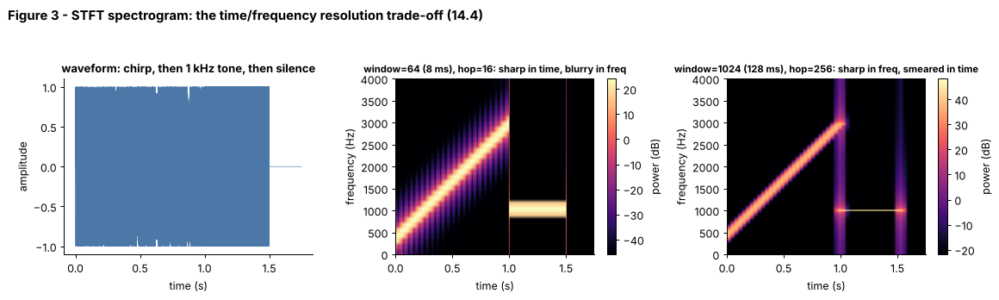
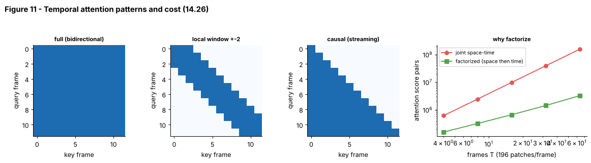

# Tier 14 — Speech, Audio & Video AI

> **Phase 2 · Transformers & Foundation Models** · Author: Claude draft (see `CHAPTER_STATUS.md`) · Status: `AUTHOR_DRAFT` (Critic / Code-review / Final-review pending)
> This file is the **tier overview and index**. Each of the 33 roadmap concepts has its own file (`NN.CC-*.md`) in this folder following the 23-section Standard Concept Format. Real-model details (Whisper, codecs, video LLMs) are case studies marked `REVIEW_REQUIRED`.

**Prerequisites:** Tier 1 (vectors, FFT intuition via linear algebra), [Tier 6](../tier-06-tokenization-embeddings/README.md) (tokens, embeddings), [Tier 7](../tier-07-attention/README.md) and [Tier 8](../tier-08-transformer-architecture/README.md) (attention, transformer blocks), [Tier 13](../tier-13-vision-ai/README.md) (patches, ViT).
**Leads to:** [Tier 11 LLM Inference Optimization](../tier-11-llm-inference-optimization/README.md) (streaming, caching), later multimodal and agent tiers (voice agents, video RAG).

**Tier goal.** After this tier you can explain how sound becomes numbers (sampling, aliasing, STFT, mel), how speech models turn audio into text (CTC, encoder-decoder, Whisper-style systems) and back (TTS, vocoders, codecs), how video becomes tokens (frames, sampling, tubelets, temporal attention), and how latency, quality and cost are measured. You also *build* a speech transcription + audio/video representation lab from scratch, with numbers.

---

## 1 · The big picture

```
 SOUND                                                                       VIDEO
 waveform ─► sampling/quantize ─► STFT ─► mel ─► encoder ─┬─► CTC / decoder ─► text (ASR)      frames [T,H,W,C] ─► sample ─► patches/tubelets ─► temporal attention
 (14.1-14.3)   (14.2)           (14.4) (14.5)   (14.7)   └─► codec tokens ◄─► LM (14.8)        (14.21-14.23)         (14.25-14.26)              (14.27-14.28)
 text ─► TTS acoustic model ─► mel/codes ─► vocoder ─► waveform (14.16-14.17)                  shots (14.24)    video embeddings ─► video-language models
 VAD (14.13) ─► diarization (14.14) ─► alignment/timestamps (14.15)                           ───────────── audio-video-text alignment + sync (14.29-14.30) ─────────────
 streaming + realtime (14.18-14.19, 14.31)     evaluation (14.20, 14.32)     cost/performance (14.33)
```

Audio and video are **much longer than text**: 16 000 numbers per second of audio, tens of thousands of pixels per frame. Almost every technique in this tier is a way to *compress along time* (spectrogram frames, strided encoders, codec tokens, frame sampling, tubelets) while keeping the information a model needs, and to *keep delay and cost bounded* when the input is a live stream.

---

## 2 · How to use this tier (read → see → play → build)

| Step | What | Where |
|---|---|---|
| 1. Read | One file per concept (start with 14.2, 14.4, 14.5, 14.10, 14.23) | the files `NN.CC-*.md` in this folder, index in section 5 |
| 2. **See** | 11 labelled figures + 3 animated GIFs | [`figures/`](figures), gallery in section 3 |
| 3. **Play** | 5 interactive pages with sliders (open in a browser) | [`interactive/`](interactive), section 4 |
| 4. **Build** | Audio core + toy CTC ASR + video core + latency/quality measurements, with 37 tests | [`lab/`](lab), section 6 |
| 5. **Regenerate** | All figures come from one script (~1 min; trains the toy model) | `python figures/src/make_figures.py` |

No data is downloaded anywhere: audio is synthesised (tones, chirps, noise, two-tone "phoneme" bursts) and video is a synthetic moving-square clip with hard cuts. Real speech/video would change the numbers, not the methods.

> **Note on animation tooling.** GIFs use Matplotlib `PillowWriter` (no Manim).

---

## 3 · Visual gallery


*Figure 1 — Left: a 5 Hz tone with 8 samples per cycle. Middle: 8 Hz sampling cannot represent it; samples fit a 3 Hz alias (red). Right: 3-bit vs 8-bit quantization. Concepts: [14.1](14.01-audio-waveforms.md), [14.2](14.02-sampling-rate.md).*


*Figure 2 — Top: amplitude and frequency changed separately. Bottom: a 3-tone mixture in time vs frequency, and phase shifts. Concept: [14.3](14.03-amplitude-and-frequency.md).*



*Figure 3 — Same chirp + tone with an 8 ms and a 128 ms window: time vs frequency resolution. Concept: [14.4](14.04-spectrograms.md).*


*Figure 12 (GIF) — Window slides, FFT of the slice, spectrogram gains a column. Concept: [14.4](14.04-spectrograms.md).*


*Figure 4 — Triangular mel filters, the mel curve, and the log-mel of a synthetic utterance. Concept: [14.5](14.05-mel-spectrograms.md).*


*Figure 5 — Pre-emphasis, CMVN, and raw audio data rates. Concept: [14.6](14.06-audio-preprocessing.md).*


*Figure 6 — Residual vector quantization: error falls and bitrate rises with each extra codebook stage. Concept: [14.8](14.08-audio-tokenization-and-neural-codecs.md).*


*Figure 7 — Peaky CTC posteriors of the trained toy model, forced-alignment bands, training loss. Concepts: [14.9](14.09-automatic-speech-recognition-asr.md), [14.10](14.10-ctc.md), [14.15](14.15-timestamps-alignment.md).*


*Figure 13 (GIF) — Posteriors revealed frame by frame; the path collapses to text. Concept: [14.10](14.10-ctc.md).*


*Figure 8 — Waveform, energy-VAD flags, and speaker clusters for a two-"speaker" synthetic clip. Concepts: [14.13](14.13-speech-segmentation.md), [14.14](14.14-speaker-diarization.md).*


*Figure 9 — Chunk/lookahead latency and an illustrative cascaded voice-agent budget. Concepts: [14.18](14.18-streaming-speech.md), [14.19](14.19-realtime-speech-systems.md).*


*Figure 10 — Eight uniformly sampled frames of the synthetic video and histogram-distance spikes at the two cuts. Concepts: [14.21](14.21-video-as-spatial-temporal-data.md), [14.22](14.22-video-frames.md), [14.23](14.23-frame-sampling.md), [14.24](14.24-scene-shot-segmentation.md).*


*Figure 14 (GIF) — Scanning for shot boundaries. Concept: [14.24](14.24-scene-shot-segmentation.md).*



*Figure 11 — Full, local and causal temporal masks; joint vs factorized attention cost. Concept: [14.26](14.26-temporal-attention.md).*

---

## 4 · Interactive explorers

Open the HTML in a browser; they are self-contained (no internet, no install, JavaScript FFT inside).

| Explorer | Adjustable controls | Teaches |
|---|---|---|
| [`sampling_explorer.html`](interactive/sampling_explorer.html) | tone frequency, sample rate, bit depth, amplitude, window | 14.1, 14.2, 14.3 |
| [`spectrogram_mel_explorer.html`](interactive/spectrogram_mel_explorer.html) | signal type, window size, hop, mel bands, noise | 14.4, 14.5 |
| [`ctc_wer_lab.html`](interactive/ctc_wer_lab.html) | frame path text, reference/hypothesis text, WER vs CER | 14.10, 14.20 |
| [`video_sampling_explorer.html`](interactive/video_sampling_explorer.html) | clip length, fps, strategy, K/stride/fps, shot length, tokens/frame, price | 14.23, 14.24, 14.28, 14.33 |
| [`latency_sync_cost.html`](interactive/latency_sync_cost.html) | chunk/lookahead/compute, agent stage latencies, A/V offset, volume, API price, RTF, GPU price | 14.18, 14.19, 14.30, 14.31, 14.33 |

---

## 5 · Concept index (33 concepts, one file each)

| # | Concept (link) | Priority | Difficulty |
|---|---|---|---|
| 14.1 | [Audio waveforms](14.01-audio-waveforms.md) | Critical | Beginner |
| 14.2 | [Sampling rate](14.02-sampling-rate.md) | Critical | Beginner |
| 14.3 | [Amplitude and frequency](14.03-amplitude-and-frequency.md) | Critical | Beginner |
| 14.4 | [Spectrograms](14.04-spectrograms.md) | Critical | Intermediate |
| 14.5 | [Mel spectrograms](14.05-mel-spectrograms.md) | Critical | Intermediate |
| 14.6 | [Audio preprocessing](14.06-audio-preprocessing.md) | High | Beginner |
| 14.7 | [Audio embeddings](14.07-audio-embeddings.md) | High | Intermediate |
| 14.8 | [Audio tokenization and neural codecs](14.08-audio-tokenization-and-neural-codecs.md) | High | Advanced |
| 14.9 | [Automatic Speech Recognition (ASR)](14.09-automatic-speech-recognition-asr.md) | Critical | Intermediate |
| 14.10 | [CTC](14.10-ctc.md) | Critical | Advanced |
| 14.11 | [Encoder-decoder ASR](14.11-encoder-decoder-asr.md) | High | Advanced |
| 14.12 | [Whisper as an ASR case study](14.12-whisper-as-an-asr-case-study.md) | High | Intermediate |
| 14.13 | [Speech segmentation](14.13-speech-segmentation.md) | High | Intermediate |
| 14.14 | [Speaker diarization](14.14-speaker-diarization.md) | High | Advanced |
| 14.15 | [Timestamps/alignment](14.15-timestamps-alignment.md) | High | Intermediate |
| 14.16 | [Text-to-Speech (TTS)](14.16-text-to-speech-tts.md) | High | Advanced |
| 14.17 | [Vocoders](14.17-vocoders.md) | High | Advanced |
| 14.18 | [Streaming speech](14.18-streaming-speech.md) | High | Advanced |
| 14.19 | [Realtime speech systems](14.19-realtime-speech-systems.md) | High | Advanced |
| 14.20 | [Audio evaluation](14.20-audio-evaluation.md) | High | Intermediate |
| 14.21 | [Video as spatial + temporal data](14.21-video-as-spatial-temporal-data.md) | Critical | Beginner |
| 14.22 | [Video frames](14.22-video-frames.md) | High | Beginner |
| 14.23 | [Frame sampling](14.23-frame-sampling.md) | Critical | Intermediate |
| 14.24 | [Scene/shot segmentation](14.24-scene-shot-segmentation.md) | High | Intermediate |
| 14.25 | [Temporal representation](14.25-temporal-representation.md) | High | Intermediate |
| 14.26 | [Temporal attention](14.26-temporal-attention.md) | High | Advanced |
| 14.27 | [Video embeddings](14.27-video-embeddings.md) | High | Intermediate |
| 14.28 | [Video-language models](14.28-video-language-models.md) | High | Advanced |
| 14.29 | [Audio-video-text alignment](14.29-audio-video-text-alignment.md) | High | Advanced |
| 14.30 | [Multimodal synchronization](14.30-multimodal-synchronization.md) | Medium | Intermediate |
| 14.31 | [Streaming/realtime video considerations](14.31-streaming-realtime-video-considerations.md) | Medium | Advanced |
| 14.32 | [Video evaluation](14.32-video-evaluation.md) | Medium | Intermediate |
| 14.33 | [Audio/video performance and cost considerations](14.33-audio-video-performance-and-cost-considerations.md) | High | Intermediate |

Suggested reading order: 14.1 → 14.2 → 14.4 → 14.5 → 14.6 → 14.9 → 14.10 → 14.11/14.12 → 14.13 → 14.15 → 14.18/14.19 → 14.8 → 14.16/14.17 → 14.21 → 14.23 → 14.24 → 14.25/14.26 → 14.27/14.28 → 14.29/14.30 → 14.20/14.32/14.33.

---

## 6 · Build: speech transcription + audio/video representation laboratory

| File | What it is |
|---|---|
| [`lab/audio_core.py`](lab/audio_core.py) | synthetic tones/chirps/noise, quantization & aliasing, resampling, STFT/ISTFT, mel filterbank & log-mel, Griffin-Lim, pre-emphasis/CMVN, residual VQ, energy VAD, toy diarization (k-means), edit distance / WER / CER, RTF and streaming-latency helpers |
| [`lab/ctc_asr.py`](lab/ctc_asr.py) | synthetic "phoneme" utterance generator, tiny Conv+BiGRU framewise classifier, CTC training, collapse, greedy and prefix-beam decoding, CTC forced alignment, chunked pseudo-streaming |
| [`lab/video_core.py`](lab/video_core.py) | synthetic video with cuts, uniform/stride/fps frame samplers, histogram shot detector, tubelet patchify, temporal attention masks and cost, A/V offset estimate, temporal IoU / recall@K, cost models |
| [`lab/lab_demo.py`](lab/lab_demo.py) | end-to-end run: train, decode, measure quality (CER) and latency (RTF), align, stream, detect shots, cost |
| [`lab/test_tier14.py`](lab/test_tier14.py) | 37 pytest tests |
| [`figures/src/make_figures.py`](figures/src/make_figures.py) | regenerates all figures and GIFs |

```bash
cd lab && python -m pytest -q      # 37 passed
python lab_demo.py                 # ~20-30 s on 2 CPU threads
python ../figures/src/make_figures.py  # regenerate figures (~1 min)
```

**Results from one run of `python lab_demo.py`** (CPU, 2 threads; CTC model trained 30 epochs on 200 synthetic utterances; evaluated on 60 held-out ones; numbers vary a little by hardware, and this is a *toy synthetic task*, not real speech):

| Measurement | Value |
|---|---|
| CTC training loss, epoch 1 → 30 | 25.6 → 0.04 |
| Greedy decoding | CER 5.7%, utterance error rate 10%, RTF 0.004 |
| Prefix beam search (beam 8) | CER 5.1%, utterance error rate 10%, RTF 0.022 (about 6x slower than greedy) |
| Forced alignment of `babcec` | b 2-9, a 14-24, b 28-36, c 41-46, e 51-59, c 65-74 (frames of 10 ms) |
| Pseudo-streaming (200 ms chunks) | `babcec` recovered; worst-case algorithmic latency 0.21 s (chunk + compute 10 ms) |
| Shot detector on 90-frame synthetic video | cuts at frames [30, 60] (exact) |
| Uniform-8 sampling | frames [5, 16, 28, 39, 50, 61, 73, 84] |
| Cost model: 10 min at 1 fps, 256 tokens/frame, 1 USD per 1M tokens | 600 frames, 153 600 tokens, 0.15 USD (all three inputs are *parameters*, not quotes) |

**What the measurements teach.** (1) CTC training sits on an all-blank plateau for several epochs before alignments emerge (Figure 7, bottom left). (2) Beam search buys a small accuracy gain for several times the decode time; the real win appears only when an LM is added. (3) Chunk size sets latency linearly (Figure 9). (4) Sampling choices change visual-token cost linearly and coverage non-linearly.

**Exercises**

1. Sweep `snr_noise` in `synth_utterance` and plot CER vs noise level with bootstrap CIs. ([14.20](14.20-audio-evaluation.md))
2. Change window/hop/`n_mels` in `ctc_asr.make_dataset`, retrain, and compare CER and RTF. Which setting breaks first? ([14.4](14.04-spectrograms.md), [14.5](14.05-mel-spectrograms.md))
3. Build a fade between two shots in `synth_video` and make the shot detector find it. ([14.24](14.24-scene-shot-segmentation.md))
4. Replace the BiGRU by a causal GRU and compare real streaming against the pseudo-streaming of `streaming_greedy`. ([14.18](14.18-streaming-speech.md))
5. Fit `ResidualVQ` on log-mel frames from the synthetic utterances and measure reconstruction error vs stages. ([14.8](14.08-audio-tokenization-and-neural-codecs.md))
6. Estimate A/V offset in sliding windows with simulated drift. ([14.30](14.30-multimodal-synchronization.md))

---

## 7 · Tier interview kit

**Basic.** What does Nyquist say? What is a spectrogram, and what is mel? What does WER measure?
**Intermediate.** Explain CTC's blank and collapse. Compare CTC, transducer and encoder-decoder ASR. How does uniform-K differ from fixed-fps frame sampling?
**Advanced.** Why does factorized space-time attention save cost? How does residual VQ make audio tokens for an LM? How would you force-align a transcript to audio?
**Scenario.** *Your Whisper-style transcription hallucinates sentences on silent stretches of long calls, and the voice agent built on top feels slow.* (VAD gating and chunking [14.13](14.13-speech-segmentation.md), decoding safeguards [14.12](14.12-whisper-as-an-asr-case-study.md); overlap stages, stream and cancel on barge-in [14.19](14.19-realtime-speech-systems.md); measure per-turn timeline and RTF [14.20](14.20-audio-evaluation.md), [14.33](14.33-audio-video-performance-and-cost-considerations.md).)

**60-second tier summary.** *"Audio is a long 1-D signal, so we sample it (above twice the top frequency), slice it into short windows, and turn it into log-mel frames, a compact ear-like image. Speech recognition then maps frames to text with CTC, an attention decoder or a transducer; synthesis runs the other way through acoustic models, vocoders or codec tokens. Video adds two axes, space and time, and is so redundant that we sample frames, find shots and compress with tubelets and factorized attention. In production the questions are latency, alignment across modalities and cost per minute, so we measure RTF, WER by slice and tokens per second of video."*

## 8 · Tier revision questions

1. Why does a 5 kHz tone sampled at 8 kHz look like 3 kHz?
2. What trade-off does the STFT window length control?
3. Why are mel filters wider at high frequencies?
4. How does CTC handle repeated letters such as "ll"?
5. Why can encoder-decoder ASR hallucinate while CTC rarely does?
6. What does RVQ's second codebook quantize?
7. State the latency formula of a chunked streaming recogniser.
8. Why can a 1 fps video sampler miss a 0.5 s event, and how is that like aliasing?
9. What do single-frame and shuffled-frame baselines test?
10. Which levers reduce the cost of a video-LLM request?

## 9 · Forward references

Streaming/caching and serving → [Tier 11](../tier-11-llm-inference-optimization/README.md). Attention math → Tier 7; transformer blocks → Tier 8; patch embeddings → Tier 13. Evaluation gates and safety (including voice-cloning risks) → Tier 15. Voice agents, tools and RAG over audio/video → later application tiers.

## 10 · Review status

| Item | State |
|---|---|
| Concept files (33) | `AUTHOR_DRAFT`; structure validated by `tools/check_concepts.py` |
| Code (`lab/`) | **TESTED** — `pytest`: 37 passed (Python 3.13, NumPy, PyTorch CPU) |
| Concept-file snippets | **TESTED** — every snippet marked "run inside lab/" (and the small PyTorch shape demos) was executed; the Whisper/codec/library snippets are commented out and labelled *not run* |
| Interactive pages (5) | **TESTED** in headless Chromium via `tools/check_interactive.py`: no JS errors, sliders exercised |
| Figures (11 PNG + 3 GIF) | regenerated by script; spot-checked visually |
| Real-model facts (Whisper, EnCodec/SoundStream, HiFi-GAN, VALL-E, ViViT/TimeSformer, video LLMs, benchmarks), standards (ITU sync tolerances, Nyquist-related rules of thumb), prices, latency targets, library APIs | `REVIEW_REQUIRED` (marked inline) |
| Toy-model numbers (CER, RTF, alignments) | measured on **synthetic** data only; do not transfer to real speech |
| Critic / Code-review / Final-review | pending per `CHAPTER_STATUS.md` |
