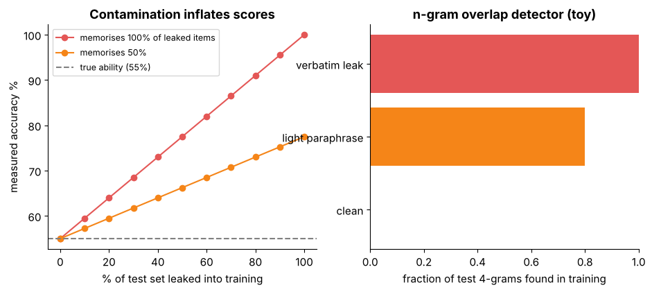

## 15.21 Memorization/data-leakage evaluation

Metadata:

- Tier: 15 — Foundation-Model Evaluation & Safety
- Phase: 2 — Transformers & Foundation Models
- Priority: Critical
- Difficulty: Intermediate
- Interview Importance: High
- Hands-on Importance: High
- Prerequisites: [15.5 Perplexity](15.05-perplexity.md), [15.7 Benchmark datasets](15.07-benchmark-datasets.md)
- Leads To: [15.20 Privacy evaluation](15.20-privacy-evaluation.md), [15.6 Benchmark design](15.06-benchmark-design.md)

---

### 1. WHAT IS IT?

Memorization/data-leakage evaluation checks whether the model saw the test data (contamination) or can reproduce training data verbatim.

### 2. WHY DOES IT EXIST?

Contamination inflates benchmark scores (Figure 5) and memorisation causes privacy and copyright risk. Both undermine the meaning of a score.

### 3. DETAILED EXPLANATION

Contamination detection:
- **n-gram overlap** between test items and the training corpus (when the corpus is available): fraction of an item's n-grams found in training (n about 8-13 in practice; the lab toy uses 4).
- **Black-box probes**: complete the second half of a test item given the first; compare verbatim reproduction against paraphrased or newly written items; compare performance on original vs rewritten or newer items.
- **Perplexity comparison**: unusually low perplexity on test text vs matched fresh text.
- **Canary strings** placed in benchmarks and checked for in training data.

Mitigations: private held-out sets, dynamic or time-split benchmarks, rewriting items, decontaminating training data, reporting contamination estimates beside scores.

Memorisation of training data: extraction attempts with known prefixes ([15.20 Privacy evaluation](15.20-privacy-evaluation.md)), repeated-substring statistics, and per-example loss analysis. Larger models and duplicated data tend to memorise more (empirical; REVIEW_REQUIRED).

### 4. HOW DOES IT WORK?

Compute overlap -> flag items above a threshold -> report score on clean vs flagged subsets -> if clean < flagged, contamination inflates the headline.



*Figure 5 - Contamination inflates measured accuracy (left); an n-gram overlap check flags leaked items (right).*

### 5. SIMPLE EXAMPLE

A student who saw the exam questions beforehand scores high without understanding.

### 6. TECHNICAL EXAMPLE

Of 1,000 items, 150 are flagged; accuracy on flagged 0.82, on clean 0.61: the headline 0.65 overstates ability, and the clean score is the honest one.

### 7. CODE

```python
# run inside lab/
from metrics import ngram_overlap
train = ["the quick brown fox jumps over the lazy dog near the river bank"]
print(ngram_overlap("the quick brown fox jumps over the lazy dog", train, n=4))        # 1.0 verbatim leak
print(ngram_overlap("a totally different question about physics", train, n=4))        # 0.0
```

Lab code: [`lab/metrics.py`](lab/metrics.py).

### 8. INPUT → PROCESS → OUTPUT

```
test items + training corpus (or probes) -> overlap / probe scores -> flagged vs clean subsets -> adjusted score
```

### 9. ENTERPRISE USE CASE

Benchmark owners keep private test splits and refresh them; buyers ask vendors for decontamination statements.

### 10. AI ENGINEERING CONNECTION

Determines whether pretraining/fine-tuning data (Tiers 9-10) polluted evaluation; connects to privacy ([15.20 Privacy evaluation](15.20-privacy-evaluation.md)).

### 11. ADVANTAGES

- Restores meaning to scores.

### 12. LIMITATIONS

- Needs corpus access for exact detection; paraphrased leaks evade n-grams.

### 13. TRADE-OFFS

- Strict detection removes valid items; looser misses leaks.

### 14. COMMON MISTAKES

- Assuming no contamination for public benchmarks.
- Only checking exact matches.

### 15. PERFORMANCE / COST CONSIDERATIONS

Overlap search over large corpora needs indexing (suffix arrays or hashing).

### 16. SECURITY CONSIDERATIONS

Leaked private test sets are a security incident for the benchmark.

### 17. INTERVIEW EXPLANATION

Contamination means test data leaked into training; memorisation means verbatim reproduction. I detect them with n-gram overlap, completion probes and clean-vs-flagged score comparison, and report the clean subset score beside the headline.

### 18. RAPID-FIRE ANSWER

Compare flagged vs clean; trust the clean score.

### 19. INTERVIEW QUESTIONS

- **Basic:** What is benchmark contamination?
- **Intermediate:** How do you detect it without the training corpus?
- **Advanced:** Why do n-gram checks miss paraphrased leaks?
- **Scenario:** A vendor's score jumped 8 points overnight; what do you check?

### 20. HANDS-ON EXERCISE

Lower n to 2 in the snippet and observe false positives on the 'clean' item.

### 21. REVISION QUESTIONS

- Why report clean-subset scores?
- What is a canary string?

### 22. RELATED CONCEPTS

[15.5 Perplexity](15.05-perplexity.md), [15.7 Benchmark datasets](15.07-benchmark-datasets.md), [15.20 Privacy evaluation](15.20-privacy-evaluation.md).

### 23. ONE-LINE MEMORY HOOK

A score is only skill if the answers were not in the training data.
