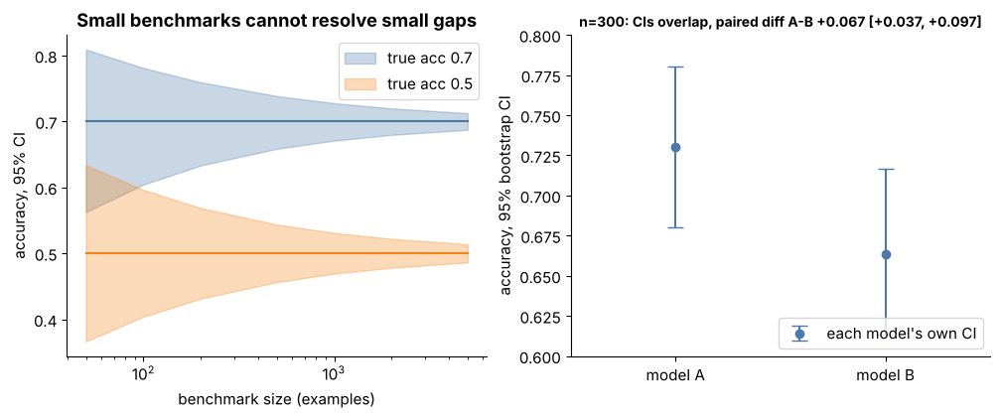

## 15.33 Model comparison

Metadata:

- Tier: 15 — Foundation-Model Evaluation & Safety
- Phase: 2 — Transformers & Foundation Models
- Priority: Critical
- Difficulty: Advanced
- Interview Importance: Very high
- Hands-on Importance: High
- Prerequisites: [15.6 Benchmark design](15.06-benchmark-design.md), [15.29 Evaluation reproducibility](15.29-evaluation-reproducibility.md), [15.30 Evaluation versioning](15.30-evaluation-versioning.md)
- Leads To: [15.32 Evaluation gates](15.32-evaluation-gates.md), [15.34 Release/readiness criteria](15.34-release-readiness-criteria.md)

---

### 1. WHAT IS IT?

Model comparison decides whether one model is genuinely better than another on a task, accounting for sampling noise, correlated errors and multiple comparisons.

### 2. WHY DOES IT EXIST?

Leaderboard differences of a point or two are usually noise; shipping on noise wastes money and can regress quality.

### 3. DETAILED EXPLANATION

Use **paired** analysis: both models answer the same items, so compare per-item scores.
- **Paired bootstrap**: resample items with replacement, recompute mean(A) - mean(B), take percentile interval and P(A>B). Because errors are correlated, the paired interval is much tighter than overlapping per-model intervals (Figure 4 right; explorer).
- **McNemar / sign tests** are classical alternatives for binary correctness (REVIEW_REQUIRED for details).
- Check **practical significance**: is the gain big enough to matter after cost and latency?
- **Multiple comparisons**: comparing many models or slices inflates false positives; correct or pre-register the primary comparison.
- Compare on the same dataset **version** and prompt protocol ([15.30 Evaluation versioning](15.30-evaluation-versioning.md), [15.29 Evaluation reproducibility](15.29-evaluation-reproducibility.md)); for judge-based comparisons, include judge bias controls ([15.28 LLM-as-judge concepts and limitations](15.28-llm-as-judge-concepts-and-limitations.md)).
- Report effect size, interval and sample size, not just 'A wins'.

Example from the lab: `compare(a, b)` refuses mismatched dataset versions and returns difference, CI and P(A better).

### 4. HOW DOES IT WORK?

Align per-item scores -> bootstrap the mean difference -> read the interval -> decide with a pre-agreed margin.



*Figure 4 - Right panel: individual intervals overlap but the paired difference is significant.*

Play with it: [explore `benchmark_ci.html`](interactive/benchmark_ci.html) (controls: size, accuracy, gap, error overlap, resamples).

### 5. SIMPLE EXAMPLE

Two runners racing on the same track on the same day is a fairer comparison than comparing times from different days.

### 6. TECHNICAL EXAMPLE

n=300 items, accuracy 0.73 vs 0.66: unpaired intervals overlap, paired difference +0.067 with 95% interval [+0.037, +0.097]: B is reliably worse (Figure 4).

### 7. CODE

```python
# run inside lab/
import numpy as np
from metrics import paired_bootstrap
rng = np.random.default_rng(0)
a = (rng.random(300) < 0.72).astype(float)
b = np.where((a == 1) & (rng.random(300) < 0.06), 0.0, a)   # B loses ~6% of A's wins, errors strongly correlated
print(paired_bootstrap(a, b))
```

Lab code: [`lab/evalharness.py`](lab/evalharness.py), [`lab/metrics.py`](lab/metrics.py).

### 8. INPUT → PROCESS → OUTPUT

```
scores_A, scores_B on same items -> per-item differences -> bootstrap -> diff, 95% CI, P(A>B) -> decision with margin
```

### 9. ENTERPRISE USE CASE

Procurement and model-selection reviews require paired comparisons with intervals and a pre-registered primary metric.

### 10. AI ENGINEERING CONNECTION

Used for model upgrades, prompt A/B comparisons offline and as a precursor to online experiments (Tier 30).

### 11. ADVANTAGES

- Fewer items needed than unpaired; honest uncertainty.

### 12. LIMITATIONS

- Assumes items are i.i.d. samples; ignores item dependence; multiple comparisons need care.

### 13. TRADE-OFFS

- Rigour (more data) vs speed.

### 14. COMMON MISTAKES

- Comparing overlapping intervals only.
- Unpaired tests on paired data.
- Testing many slices and reporting the best.

### 15. PERFORMANCE / COST CONSIDERATIONS

Bootstrap of 2,000 resamples is cheap on per-item scores.

### 16. SECURITY CONSIDERATIONS

Adversarial vendors can cherry-pick datasets; own the evaluation set.

### 17. INTERVIEW EXPLANATION

To compare models I use paired per-item scores and a paired bootstrap for the difference, report effect size with interval and P(A>B), require a practical margin, control multiple comparisons and fix dataset version and prompt protocol.

### 18. RAPID-FIRE ANSWER

Paired bootstrap on the same items; effect size, interval, margin.

### 19. INTERVIEW QUESTIONS

- **Basic:** Why paired rather than unpaired?
- **Intermediate:** What does the bootstrap interval tell you?
- **Advanced:** How to handle comparing 10 models?
- **Scenario:** Vendor B claims +1.2 points on a 400-item set; what do you reply?

### 20. HANDS-ON EXERCISE

Vary the loss rate (0.06) in the snippet until the interval includes 0; interpret.

### 21. REVISION QUESTIONS

- Why correlated errors tighten paired intervals?
- Practical significance?

### 22. RELATED CONCEPTS

[15.6 Benchmark design](15.06-benchmark-design.md), [15.29 Evaluation reproducibility](15.29-evaluation-reproducibility.md), [15.32 Evaluation gates](15.32-evaluation-gates.md).

### 23. ONE-LINE MEMORY HOOK

Same questions, paired differences, honest interval.
