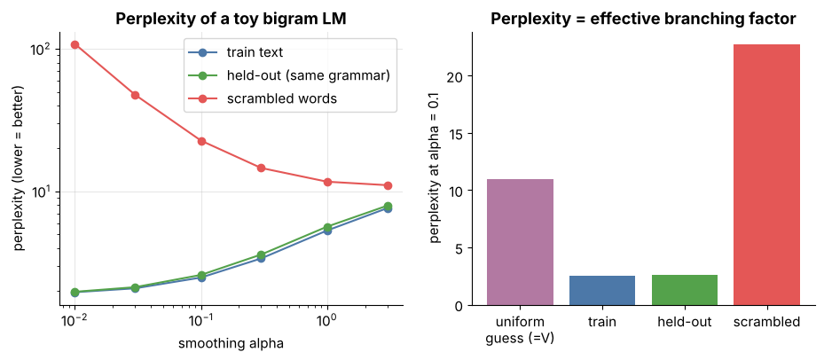
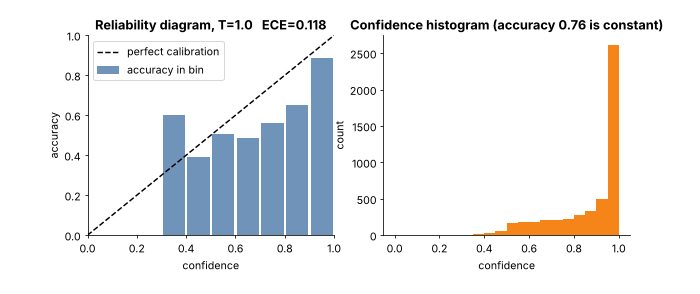
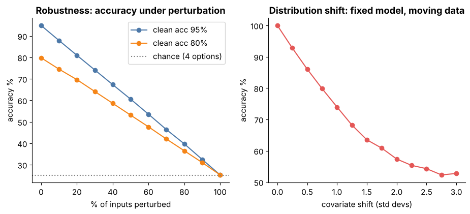
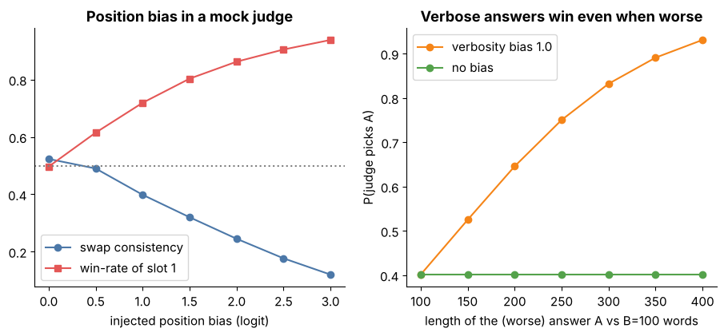

# Tier 15 — Foundation-Model Evaluation & Safety

> **Phase 2 · Transformers & Foundation Models** · Author: Claude draft · Status: `AUTHOR_DRAFT` (Critic / Code-review / Final-review pending)
> This file is the **tier overview and index**. Each of the 35 roadmap concepts has its own file (`NN.CC-*.md`) in this folder following the 23-section Standard Concept Format.

**Prerequisites:** Tier 1-3 (probability, basic ML, classification metrics intuition), Tier 6 (tokenization, for the perplexity caveat), Tier 9-10 (what pretraining and post-training produce).
**Leads to:** Tier 30 (AI evaluation at application level: RAG, agents, online evaluation), Tier 32 (AI security, guardrails, prompt injection). Those tiers reuse the harness ideas built here and are not re-taught here.

**Tier goal.** After this tier you can say what a benchmark number does and does not prove, put an interval around it, compare two models honestly, measure calibration, bias, privacy, contamination and harm, validate automatic judges against humans, and turn all of it into a versioned, reproducible evaluation harness with release gates that fail closed and say why.

All data and "models" are **synthetic** (a controllable classifier, a bigram LM, a mock judge with injectable bias, toy risk scores). Nothing is downloaded and no API key is used. Numbers shown illustrate mechanisms; they are not measurements of real models. Real benchmark names appear only as examples (`REVIEW_REQUIRED` for details).

---

## 1 · The big picture

```
 objectives ─► datasets ─► scorers ─► uncertainty ─► comparison ─► gates ─► release decision
 (15.1-15.4)  (15.6-15.8,   (15.5, 15.9-15.14, (15.6, 15.33)  (15.33)   (15.32)   (15.34, 15.35)
               15.25-15.26)  15.27-15.28)
                  ▲   stress tests: robustness, shift, bias/fairness, privacy, contamination, safety, red teaming (15.15-15.24)
                  └── reproducibility + versioning + pipelines (15.29-15.31) make every arrow repeatable
```

A foundation model has no single task, so quality is a **bundle of measurements with uncertainty**, interpreted against objectives and decided with explicit gates. The most common failure is not a wrong metric but a number without an interval, a version or a baseline.

---

## 2 · How to use this tier (read → see → play → build)

| Step | What | Where |
|---|---|---|
| 1. Read | One file per concept (start with 15.1, 15.6, 15.10, 15.11, 15.32, 15.33) | the files `NN.CC-*.md` in this folder, index below |
| 2. **See** | Labelled figures and two animated GIFs | [`figures/`](figures), gallery below |
| 3. **Play** | Five interactive pages with sliders (open in a browser, no network) | [`interactive/`](interactive) |
| 4. **Build** | Evaluation harness with golden/regression datasets, human review import, versioned results, seeds and release gates, plus tests | [`lab/`](lab) |
| 5. **Regenerate** | All figures from one script | `python figures/src/make_figures.py` |

---

## 3 · Visual gallery



*Figure 1 - Perplexity of a toy bigram LM on train, held-out and scrambled text, and as an effective branching factor. Concepts: 15.4, 15.5.*


*Figure 2 - Precision, recall and F1 versus threshold, PR curve, and confusion matrix. Concepts: 15.9, 15.10.*



*Figure 3 - Animated reliability diagram while temperature T is swept: ECE falls, accuracy stays fixed. Concepts: 15.11.*


*Figure 4 - Interval width versus benchmark size; overlapping individual intervals but a significant paired difference. Concepts: 15.6, 15.33.*


*Figure 5 - Contamination inflates scores; n-gram overlap flags leaked items. Concepts: 15.7, 15.21.*



*Figure 6 - Accuracy under input perturbation (left) and under covariate shift (right). Concepts: 15.15, 15.17.*


*Figure 7 - Demographic parity versus equalized odds for a perfect classifier and a parity-forced one. Concepts: 15.18, 15.19.*



*Figure 8 - Position and verbosity bias in a mock LLM judge. Concepts: 15.28.*


*Figure 9 - Red-team attack-success funnel and a release gate (illustrative numbers). Concepts: 15.24, 15.32, 15.34.*


*Figure 10 - Animated refusal-threshold sweep tracing the safety-versus-helpfulness frontier. Concepts: 15.22, 15.35.*

---

## 4 · Interactive explorers

| Page | What you control | Concepts |
|---|---|---|
| [`calibration.html`](interactive/calibration.html) | accuracy signal, overconfidence (sharpen), temperature, bins, sample size; "fit T" button; ECE and NLL | 15.11 |
| [`prf_threshold.html`](interactive/prf_threshold.html) | decision threshold, class separation, positive base rate; confusion matrix, P/R/F1, PR curve | 15.9, 15.10 |
| [`benchmark_ci.html`](interactive/benchmark_ci.html) | benchmark size, true accuracy, gap between models, error overlap, bootstrap resamples; paired vs unpaired view | 15.6, 15.33 |
| [`fairness_metrics.html`](interactive/fairness_metrics.html) | per-group base rate, TPR, FPR; demographic parity and equalized odds gaps | 15.18, 15.19 |
| [`release_gate.html`](interactive/release_gate.html) | candidate metrics and gate thresholds; pass/fail with reasons | 15.32, 15.34 |

---

## 5 · Concept index (one file per roadmap concept)

| # | Concept |
|---|---|
| 15.1 | [Why foundation-model evaluation is difficult](15.01-why-foundation-model-evaluation-is-difficult.md) |
| 15.2 | [Evaluation objectives](15.02-evaluation-objectives.md) |
| 15.3 | [Offline vs online evaluation](15.03-offline-vs-online-evaluation.md) |
| 15.4 | [Intrinsic vs extrinsic evaluation](15.04-intrinsic-vs-extrinsic-evaluation.md) |
| 15.5 | [Perplexity](15.05-perplexity.md) |
| 15.6 | [Benchmark design](15.06-benchmark-design.md) |
| 15.7 | [Benchmark datasets](15.07-benchmark-datasets.md) |
| 15.8 | [Task-specific evaluation](15.08-task-specific-evaluation.md) |
| 15.9 | [Accuracy](15.09-accuracy.md) |
| 15.10 | [Precision/recall/F1 in model evaluation](15.10-precision-recall-f1-in-model-evaluation.md) |
| 15.11 | [Calibration](15.11-calibration.md) |
| 15.12 | [Factuality](15.12-factuality.md) |
| 15.13 | [Hallucination](15.13-hallucination.md) |
| 15.14 | [Groundedness](15.14-groundedness.md) |
| 15.15 | [Robustness](15.15-robustness.md) |
| 15.16 | [Adversarial testing](15.16-adversarial-testing.md) |
| 15.17 | [Distribution-shift evaluation](15.17-distribution-shift-evaluation.md) |
| 15.18 | [Bias evaluation](15.18-bias-evaluation.md) |
| 15.19 | [Fairness considerations](15.19-fairness-considerations.md) |
| 15.20 | [Privacy evaluation](15.20-privacy-evaluation.md) |
| 15.21 | [Memorization/data-leakage evaluation](15.21-memorization-data-leakage-evaluation.md) |
| 15.22 | [Model safety](15.22-model-safety.md) |
| 15.23 | [Harmful-output evaluation](15.23-harmful-output-evaluation.md) |
| 15.24 | [Red teaming](15.24-red-teaming.md) |
| 15.25 | [Regression datasets](15.25-regression-datasets.md) |
| 15.26 | [Golden datasets](15.26-golden-datasets.md) |
| 15.27 | [Human evaluation](15.27-human-evaluation.md) |
| 15.28 | [LLM-as-judge concepts and limitations](15.28-llm-as-judge-concepts-and-limitations.md) |
| 15.29 | [Evaluation reproducibility](15.29-evaluation-reproducibility.md) |
| 15.30 | [Evaluation versioning](15.30-evaluation-versioning.md) |
| 15.31 | [Evaluation pipelines](15.31-evaluation-pipelines.md) |
| 15.32 | [Evaluation gates](15.32-evaluation-gates.md) |
| 15.33 | [Model comparison](15.33-model-comparison.md) |
| 15.34 | [Release/readiness criteria](15.34-release-readiness-criteria.md) |
| 15.35 | [Safety vs capability trade-offs](15.35-safety-vs-capability-trade-offs.md) |

Groups: Foundations (1-4); Metrics for LMs and tasks (5-11); Truthfulness and grounding (12-14); Robustness, shift, fairness, privacy (15-21); Safety (22-24); Datasets, humans and judges (25-28); Process: reproducibility to release (29-35).

---

## 6 · Build — model-evaluation harness ([`lab/`](lab))

| File | Purpose |
|---|---|
| [`metrics.py`](lab/metrics.py) | accuracy, confusion counts, precision/recall/F1, PR curve, perplexity, softmax, reliability bins, ECE, Brier, NLL, temperature fit, bootstrap and Wilson intervals, paired bootstrap, Cohen's kappa, group rates, demographic-parity and equalized-odds gaps, n-gram overlap |
| [`toy.py`](lab/toy.py) | synthetic stand-ins: classifier logits with controllable accuracy and over-confidence, bigram LM, `MockJudge` with position and verbosity bias, swap-consistency test, noisy-accuracy model |
| [`evalharness.py`](lab/evalharness.py) | `Example`/`Dataset` (golden, regression, benchmark; content-hash version; JSONL; `add_regression`), per-example seeding, `run_eval`, `EvalResult` (JSON, deterministic `run_id`, versioned filenames), `compare` (paired bootstrap, refuses mismatched dataset versions), `import_human_reviews` (majority vote, kappa, auto-vs-human disagreements), `Gate`/`evaluate_gates` (floor, ceiling, regression, significance, slices, hard/soft, fail closed, reasons) |
| [`demo.py`](lab/demo.py) | end-to-end toy run |
| [`test_tier15.py`](lab/test_tier15.py) | 40 pytest tests: metric formulas hand-checked (accuracy, P/R/F1, perplexity, ECE, Brier, kappa, group gaps), temperature scaling, bootstrap CI shrinkage and coverage, Wilson value, paired bootstrap, judge bias, dataset versioning, reproducibility and order-independence, JSON round trip, human-review import, gate logic |

Run: `cd lab && python -m pytest -q` and `python demo.py`.

**Results (this authoring session):** `40 passed` in about 1.6 s (Python 3.13, numpy only). Every Python snippet in the concept files was extracted and executed from `lab/` without error. `python tools/check_interactive.py` reported `ok` for all five pages. `python figures/src/make_figures.py` regenerates all ten figures in about 10 s.

---

## 7 · Tier-level interview kit

1. **"Model B scores 2 points higher on a public benchmark. Do we switch?"** Ask for n and intervals; run a paired comparison on a private golden set; check contamination; weigh cost and safety gates.
2. **"What does ECE tell you and what does it not?"** Average gap between confidence and accuracy over bins; says nothing about accuracy, depends on binning and n, and degrades under shift.
3. **"Design a release gate for an LLM feature."** Absolute floors on lower confidence bounds, regression gate vs baseline, per-slice safety gates, fail closed, reasons, versioned inputs, audited overrides.
4. **"How do you trust an LLM judge?"** Swap order, control length, different model family, rubric, calibrate against human labels with kappa, monitor drift.
5. **"Demographic parity vs equalized odds?"** Different criteria; incompatible when base rates differ; choice is normative and documented.
6. **"How do you know a safety eval is meaningful?"** Adversarial prompts, per-category worst-case, human-verified positives, intervals with budget, over-refusal measured too.

---

## 8 · Tier summary

- A score is `value + uncertainty + version + protocol`. Drop any part and it is an anecdote.
- Use paired comparisons, lower confidence bounds and slices.
- Contamination, calibration under shift and judge bias are the three silent score-killers.
- Safety is a tail property measured adversarially, per category, with over-refusal on the other axis.
- Reproducible, versioned pipelines plus fail-closed gates turn evaluation into engineering. Tier 30 scales this to applications; Tier 32 builds defences.

---

## 9 · Review status

| Item | Status |
|---|---|
| Concept files (35) | `AUTHOR_DRAFT`, structure validated by `tools/check_concepts.py` |
| Lab code and tests | 40 tests pass (run in this session); `CODE_REVIEW` pending |
| Figures and interactive pages | generated and screenshot-checked in this session; `CRITIC` pending |
| Named benchmarks, taxonomies, kappa conventions, regulatory/legal statements, documented attack cases, fairness impossibility conditions, GPU non-determinism details | `REVIEW_REQUIRED` (marked in text) |
| Thresholds in examples and gates | illustrative only; real thresholds are organisational policy (`REVIEW_REQUIRED`) |
